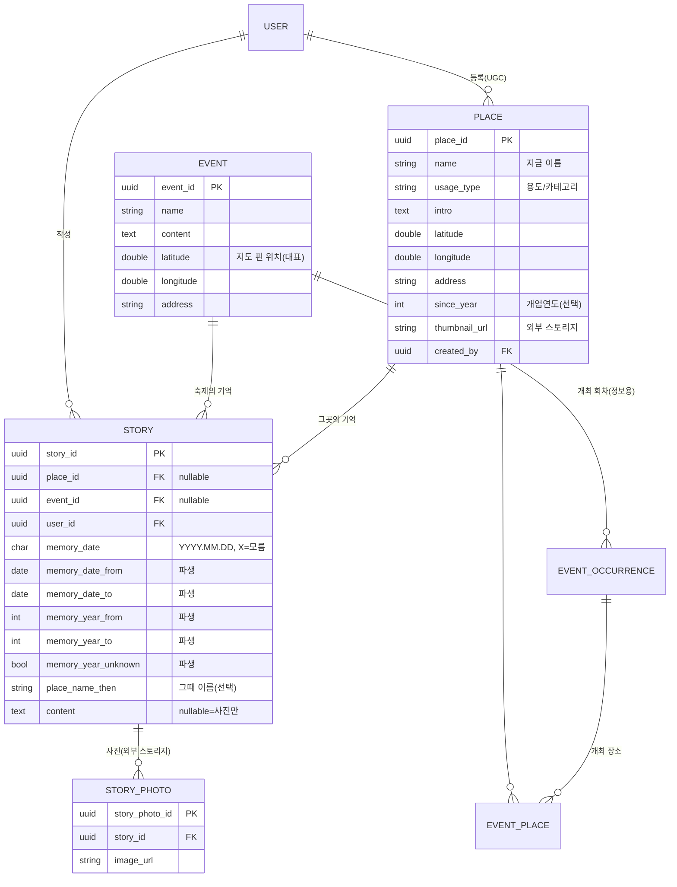

# 영천 홍보지도 앱 — DB 설계 / ERD (v5)

> **시대(era) 제거.** 시간축은 "기록(스토리) 하나하나의 기억 날짜"로 옮긴다. 장소·축제 핀을 누르면 그곳의 기록을 연도별(오름/내림)로 본다.
> 정본은 `backend/prisma/schema.prisma`. 이 문서는 사람이 읽는 설명서다.

## v4 → v5 변경 요약

| 구분 | 내용 |
|---|---|
| 삭제 | `era`, `place_era`, `era_map_layer` (과거 배경 지도·타일 파이프라인 포함 전부 삭제) |
| place | 시대별 기록이 사라지고 **장소 = 좌표 + 지금 이름**. `name`·`usage_type`·`intro`·`since_year`·`thumbnail_url`·`created_by` 가 place로 이동 |
| story 앵커 | `place_era_id`/`event_occurrence_id` → **`place_id` / `event_id`** (최소 하나 필수) |
| 기억 날짜 | `memory_year INT` → **`memory_date CHAR(10)`** (`YYYY.MM.DD`, 모르는 자리는 `X`) + 정렬용 파생 컬럼 5개 |
| 그때 이름 | `story.place_name_then` — 같은 자리의 이름 변화(예: 90년대 "중앙분식")를 기록마다 선택 입력 |
| event | 지도 핀용 대표 위치 `latitude`·`longitude`·`address` 추가. 회차(`event_occurrence`)는 개최 기간·장소 정보용으로만 유지 |

**핵심 개념**: 지도에는 두 종류의 핀(장소, 축제)이 있다. 핀을 누르면 그곳에 붙은 기록이 **기억 날짜 순**(최신 작성순 아님)으로 펼쳐진다.

---

## 1. ERD (핵심부)



---

## 2. 기억 날짜 규칙 (memory_date)

사용자는 공항 숫자판처럼 생긴 8칸(`Y Y Y Y . M M . D D`)을 드래그해 맞춘다. **모든 자리**가 `0~9` 또는 `X`(모름).

| 입력 | 뜻 | memory_date_from | memory_date_to | year_from~to |
|---|---|---|---|---|
| `1995.07.15` | 그날 | 1995-07-15 | 1995-07-15 | 1995~1995 |
| `1995.XX.XX` | 1995년 언젠가 | 1995-01-01 | 1995-12-31 | 1995~1995 |
| `199X.XX.XX` | 1990년대 | 1990-01-01 | 1999-12-31 | 1990~1999 |
| `19X5.XX.XX` | 19?5년 | 1905-01-01 | 1995-12-31 | 1905~1995 |
| `1995.0X.1X` | 1995년 1~9월, 10~19일 | 1995-01-10 | 1995-09-19 | 1995~1995 |
| `XXXX.XX.XX` | 전혀 모름 | 1800-01-01 | 오늘 | 1800~올해 (연도 미상) |

- **후보**: X 자리를 0~9로 채워 만든 날짜 중 *실제 달력에 있는 날*(13월·2월 30일·평년 2월 29일 제외)이면서 **1800-01-01 ~ 오늘(한국 시간)** 안의 것.
- 후보가 하나도 없으면 저장 거절(`INVALID_PARAMETER`). 예: `2001.02.3X`, `2027.XX.XX`.
- **숫자판 칸별 상한선(앱 입력 단계)**: 연도 칸은 0~9·X 모두. 월 첫째 `0·1·X`, 월 둘째는 01~12 안의 숫자만(첫째 0 → 1~9, 1 → 0~2). 일 첫째 `0~3·X`, 일 둘째는 01~31 안의 숫자만(첫째 0 → 1~9, 3 → 0~1). 첫째 자리를 바꿔 범위를 벗어나면 둘째 자리를 맞춘다(예: `09` 에서 첫째를 1로 → `12`). 달마다 다른 마지막 날(2월 30일 등)은 칸 단위로 막지 않고 위의 "가능한 날짜 없음"으로 안내한다. 코드: 프론트 `core/memory_date/memory_date_digit_rules.dart`.
- 파생 5개 컬럼은 **서버가 memory_date 로부터만 계산**한다(`common/memory-date/memory-date.resolver.ts`). 클라이언트가 보내지 않는다.
- 같은 규칙을 프론트(`lib/core/memory_date/`)도 구현한다 — 숫자판에서 "가능한 날짜 없음"을 즉시 보여주기 위해. 두 쪽 테스트는 같은 사례 표를 쓴다.

## 3. 타임라인 정렬 규칙

장소·축제의 기록 목록은 **기억 날짜 기준**으로 정렬한다. `order=asc|desc`, 내림차순은 오름차순을 정확히 뒤집은 것.

```
ORDER BY memory_year_unknown ASC,      -- 연도 전부 모름(XXXX)은 항상 맨 뒤
         memory_year_from   {dir},     -- 연도 묶음: 1990 < 199X(1990~1999) < 1991 …
         memory_year_to     {dir},
         memory_date_from   {dir},     -- 묶음 안에서는 가능한 가장 이른 날
         memory_date_to     {dir},
         created_at         {dir},
         story_id           {dir}      -- 완전 동률 시 순서 고정(페이지네이션 안정)
```

- 앱은 연속된 `(year_from, year_to)` 가 같은 기록들을 한 **연도 묶음**으로 보여준다. 묶음 머리글은 숫자판 모양으로 첫 기록의 연도 패턴(`1995`, `199X`, `XXXX`)을 표시.
- 오름차순 예: `1990.05.XX` → `199X.XX.XX` → `1995.XX.XX` → `1995.07.15` → … → `XXXX.XX.XX`

## 4. DDL — 변경/신규 (PostgreSQL, 참고용. 실제 생성은 Prisma Migrate)

```sql
CREATE TABLE place (
    place_id      UUID PRIMARY KEY DEFAULT gen_random_uuid(),
    name          VARCHAR(150) NOT NULL,       -- 지금 이름
    usage_type    VARCHAR(100),
    intro         TEXT,
    latitude      DOUBLE PRECISION NOT NULL,
    longitude     DOUBLE PRECISION NOT NULL,
    address       VARCHAR(255),
    since_year    INT,                         -- 개업연도(연식 표시, 선택)
    thumbnail_url VARCHAR(500),
    created_by    UUID REFERENCES "user"(user_id),
    created_at    TIMESTAMPTZ NOT NULL DEFAULT now(),
    updated_at    TIMESTAMPTZ NOT NULL DEFAULT now()
);

ALTER TABLE event ADD COLUMN latitude DOUBLE PRECISION,
                  ADD COLUMN longitude DOUBLE PRECISION,
                  ADD COLUMN address VARCHAR(255);   -- 위치 없는 축제는 지도에 안 뜸

CREATE TABLE story (
    story_id            UUID PRIMARY KEY DEFAULT gen_random_uuid(),
    place_id            UUID REFERENCES place(place_id),
    event_id            UUID REFERENCES event(event_id),
    user_id             UUID NOT NULL REFERENCES "user"(user_id),
    memory_date         CHAR(10) NOT NULL DEFAULT 'XXXX.XX.XX',
    memory_date_from    DATE NOT NULL,
    memory_date_to      DATE NOT NULL,
    memory_year_from    INT NOT NULL,
    memory_year_to      INT NOT NULL,
    memory_year_unknown BOOLEAN NOT NULL,
    place_name_then     VARCHAR(150),
    content             TEXT,
    created_at          TIMESTAMPTZ NOT NULL DEFAULT now(),
    updated_at          TIMESTAMPTZ NOT NULL DEFAULT now(),
    CONSTRAINT story_anchor_chk CHECK (place_id IS NOT NULL OR event_id IS NOT NULL)
);
CREATE INDEX story_place_timeline_idx ON story (place_id, memory_year_unknown, memory_year_from, memory_year_to, memory_date_from, memory_date_to);
CREATE INDEX story_event_timeline_idx ON story (event_id, memory_year_unknown, memory_year_from, memory_year_to, memory_date_from, memory_date_to);

DROP TABLE era_map_layer; DROP TABLE place_era; DROP TABLE era;
```

> 유지: `user`, `user_profile`, `session`, `story_photo`, `event_host`, `event_photo`, `event_occurrence`(year·start_date·end_date), `event_place`, `metric_type`, `user_metric`, `achv`, `user_achv`.
> `story_anchor_chk` 같은 CHECK 는 Prisma 스키마로 표현되지 않으므로 서비스 계층에서 검증한다(필요하면 마이그레이션 SQL에 수동 추가).

## 5. 남은 결정 (TODO)
1. UGC 검수(신고) — 초기엔 사후 신고.
2. 장소 중복 등록(같은 자리에 두 개) 병합 방식.
3. 외부 스토리지 종류(S3/R2)와 프리사인 세부.
4. 기록이 장소·축제 **둘 다**에 붙는 경우(예: 축제 때 그 가게) 허용 여부 — 현재는 허용(최소 하나).

## 변경 이력
| 날짜 | 버전 | 내용 |
|---|---|---|
| 2026-10-10 | v5 | 시대 제거, 기억 날짜(부분 날짜)·그때 이름 도입, 축제 기록을 축제에 직접 연결, 과거 배경 지도 삭제 |
| 2026-09-10 | v4 | place_era, 10년 시대, 스토리 통합, 외부 스토리지 |
